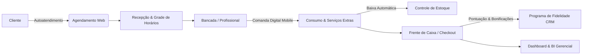

# 💇‍♀️ Sistema Libella — Gestão Inteligente para Salão de Beleza

> **Projeto de Engenharia de Software I**  
> Faculdade de Tecnologia de Sorocaba – **Fatec Sorocaba** (Centro Paula Souza)  
> Curso Superior de Tecnologia em **Análise e Desenvolvimento de Sistemas (ADS)**  
> *Primeiro Semestre de 2026*

---

## 📌 Visão Geral do Projeto

Este repositório contém o **dossiê completo de engenharia de software, levantamento de requisitos, análise de processos de negócio e prototipação de alta fidelidade** desenvolvido para o salão de beleza **Libella By Aline Sábio**, localizado em Sorocaba/SP.

O projeto foi concebido para modernizar a gestão operacional do salão — que operava com processos manuais (agenda física de papel, comandas avulsas e digitação posterior em planilhas do Excel) —, eliminando gargalos operacionais, perdas financeiras e falhas de estoque por meio de uma aplicação web responsiva (SaaS) integrada.

---

## 👥 Equipe do Projeto (Grupo 5)

* **João Vitor Pereira Reche**
* **Leonardo Cordeiro de Oliveira**
* **Otávio Augusto Vedovatto Vieira**
* **Tiago Felipe Martins Camargo**
* **Willian Kenji Fujita**

**Orientação:** Prof. Levi Rodrigues Munhoz

---

## 🎯 Contexto e Estudo de Caso: Salão Libella

Fundado em setembro de 2020 pela cabeleireira e visagista **Aline Sábio** (com passagens pela Jacques Janine e coordenação do Instituto Embelleze), o salão Libella passou por forte expansão física e de clientela, ofertando serviços que vão desde corte, escova, progressiva, mechas na touca, megahair e cronograma capilar até manicure/pedicure, spa dos pés e maquiagem.

### ⚠️ Diagnóstico da Situação Atual (*As-Is*) e Prejuízos Mapeados

Durante a fase de pesquisa de campo e entrevistas estruturadas com a gerência, recepção e equipe operacional, foram quantificados quatro gargalos críticos:

1. **Perda de Faturamento por Falha no Registro de Serviços Extras:**
   * *Causa:* Vendas adicionais realizadas na cadeira (ex: hidratação, sobrancelha, frigobar) eram calculadas de cabeça pelo profissional e esquecidas na hora do fechamento no caixa.
   * *Impacto:* Falhas em ~20% dos casos de extras, gerando prejuízo estimado de **R$ 240,00 a R$ 480,00 por mês**.

2. **Evasão de Clientes por Lentidão nos Agendamentos:**
   * *Causa:* Consulta demorada à agenda física de papel e lentidão nas respostas em canais como WhatsApp e redes sociais.
   * *Impacto:* Mais de **R$ 1.000,00 perdidos por semestre** em atendimentos que migraram para concorrentes.

3. **Desabastecimento e Estoque "Cego":**
   * *Causa:* Controle visual informal e falta de vínculo entre consumo de produtos químicos (como pó descolorante e tinturas) e as comandas realizadas.
   * *Impacto:* Compras emergenciais no varejo local com sobrepreço e risco de cancelamento de procedimentos lucrativos por falta de insumos específicos.

4. **Desequilíbrio na Escala e Ociosidade:**
   * *Causa:* Sobrecarga aos finais de semana e alta ociosidade às terças e quartas-feiras, sem histórico consolidado de dados para contratação pontual de freelancers ou ações promocionais direcionadas.

---

## 💡 Solução Proposta (*To-Be*)

O **Sistema Libella** foi projetado como uma **Aplicação Web Responsiva** que centraliza todo o fluxo de trabalho do estabelecimento em tempo real, cobrindo da experiência do cliente ao fechamento financeiro e inteligência estratégica:



---

## 🚀 Principais Módulos do Sistema

### 1. 📱 Portal de Autoatendimento do Cliente
* Agendamento dinâmico em no máximo 4 interações (serviço, profissional, data e horário livre).
* Visualização de histórico de procedimentos e próximos agendamentos.
* Cadastro do cliente com preenchimento da **Ficha de Anamnese Digital** (alergias a amônia, PPD, histórico de procedimentos químicos anteriores).

### 2. 🗓️ Gestão de Agenda e Disponibilidade Operacional
* Calendário interativo com cards de atendimentos e alteração de status em tempo real (*Em Atendimento*, *Finalizado*, *Cancelado*).
* Validação automática de concorrência e conflitos de horários e espaço físico (cadeiras/lavatórios).
* Matriz visual de disponibilidade semanal para equipe fixa e freelancers contratados para picos de movimento.

### 3. 🧾 Comandas Digitais (Versão Web & Mobile na Bancada)
* Interface exclusiva para os profissionais na bancada acompanharem e atualizarem o atendimento.
* Inclusão de **serviços extras na cadeira** e consumo de frigobar com recálculo automático da fatura.
* Registro de insumos químicos utilizados para baixa de estoque automática ao término do atendimento.

### 4. 🎁 CRM & Programa de Fidelidade Gamificado
* Histórico completo de visitas e ticket médio por cliente.
* Categorização em níveis de fidelidade: **Prata**, **Ouro** e **Platina**.
* Resgate de bonificações (descontos de 5% a 15%, hidratação gratuita, pacotes VIP) com checagem automática e bloqueio de resgates indevidos caso o saldo de pontos seja insuficiente.

### 5. 📦 Controle de Estoque Inteligente
* Parametrização de **Ponto de Reposição** (estoque mínimo) para insumos críticos.
* Alertas visuais automáticos no painel gerencial identificando produtos em estado crítico.
* Gestão simplificada para descartáveis de manicure e produtos gerais (copa/frigobar/limpeza).

### 6. 💳 Caixa (Checkout)
* Consolidação automática da comanda (serviços agendados + serviços adicionais + produtos).
* Suporte a múltiplos métodos de pagamento (Dinheiro, Cartão e PIX).
* Aplicação direta de descontos provenientes de pontos de fidelidade.

### 7. 📊 Dashboard & Relatórios Gerenciais (BI)
* Acompanhamento em tempo real de KPIs: Agendamentos do dia, Faturamento e Ticket Médio.
* Gráficos de faturamento mensal e atendimentos por semana.
* **Curva anual de sazonalidade** e detecção de períodos de baixa procura (ex: julho e fevereiro).
* **Módulo de Insights Preditivos:** sugestões automáticas de campanhas promocionais para movimentar o salão em datas de baixa demanda.

---

## 🛡️ Matriz de Controle de Acesso (RBAC)

Para garantir segurança, integridade e confidencialidade conforme os princípios da **LGPD**:

| Módulo / Funcionalidade | Cliente | Profissional | Gerência |
| :--- | :---: | :---: | :---: |
| **Autoatendimento** | Acesso Total (Próprio) | Sem Acesso | Sem Acesso |
| **Ficha de Anamnese** | Acesso Total (Própria) | Leitura (Clientes do dia) | Acesso Total |
| **Agenda Geral Diária** | Sem Acesso | Leitura (Própria agenda) | Acesso Total |
| **Gestão de Comandas** | Sem Acesso | Acesso Total (Ativas) | Acesso Total |
| **Controle de Estoque** | Sem Acesso | Sem Acesso | Acesso Total |
| **Caixa / Checkout** | Sem Acesso | Acesso Total | Acesso Total |
| **Relatórios e Faturamento** | Sem Acesso | Sem Acesso | Acesso Total |
| **Cadastro de Equipe e Serviços** | Sem Acesso | Sem Acesso | Acesso Total |

---

## ⚙️ Requisitos Não Funcionais (RNF)

* **RNF01 - Usabilidade:** Agendamento pelo cliente realizado em no máximo 4 toques/cliques.
* **RNF02 - Confiabilidade:** Disponibilidade contínua para autoatendimento 24/7 com controle transacional rigoroso contra duplo agendamento.
* **RNF03 - Desempenho:**
  * Login, consultas e agendamentos: `< 2 segundos`
  * Atualização de comanda e baixa de insumo: `< 1 segundo`
  * Renderização de dashboards e queries analíticas: `< 4 segundos`
* **RNF04 - Privacidade e Segurança:** Proteção de dados cadastrais e fichas de anamnese em conformidade com a LGPD.
* **RNF05 - Portabilidade:** Aplicação Web Responsiva compatível com Chrome, Safari, Firefox e Edge nos sistemas Windows, macOS, Android e iOS (dispensando custos de publicação em lojas de aplicativos).
* **RNF06 - Entrega e Capacitação:** Acompanhado de manual do usuário e plano de treinamento operacional da equipe.

---

## 🎨 Telas e Prototipação

O projeto conta com mais de 30 telas e fluxos prototipados de alta fidelidade, abrangendo:
* Telas de Autenticação diferenciadas (Cliente vs. Profissional)
* Ficha de Anamnese Interativa com dropdowns especializados
* Painéis de Comandas em visão desktop e versão mobile para uso em bancada
* Módulo de checkout com aplicação de regras de bonificação em tempo real
* Visão analítica gerencial completa com análise individual por profissional e alertas de sazonalidade

---

## 📂 Conteúdo do Repositório

```text
├── Grupo 5 - Controle de Salao de Beleza.pdf   # Documentação completa de Engenharia de Software I
└── README.md                                  # Visão geral estruturada do projeto
```

---

<p align="center">
  Desenvolvido com dedicação por alunos de Tecnologia em Análise e Desenvolvimento de Sistemas – <b>Fatec Sorocaba</b> 🚀
</p>
